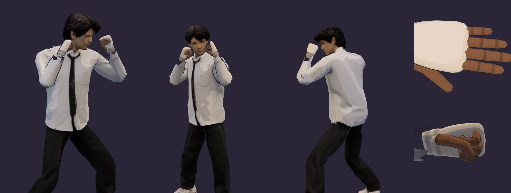
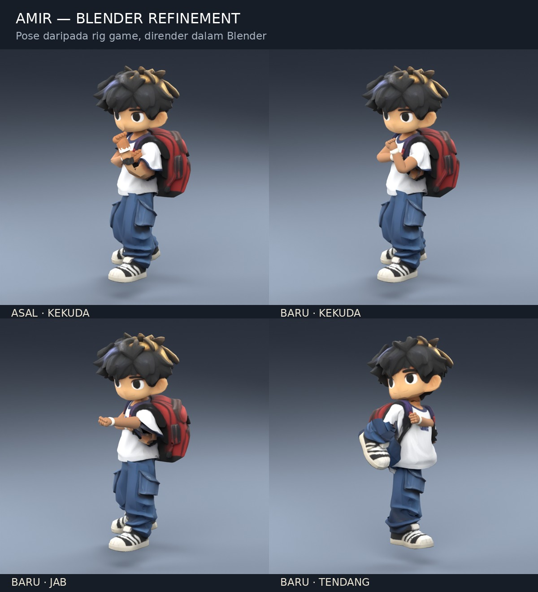
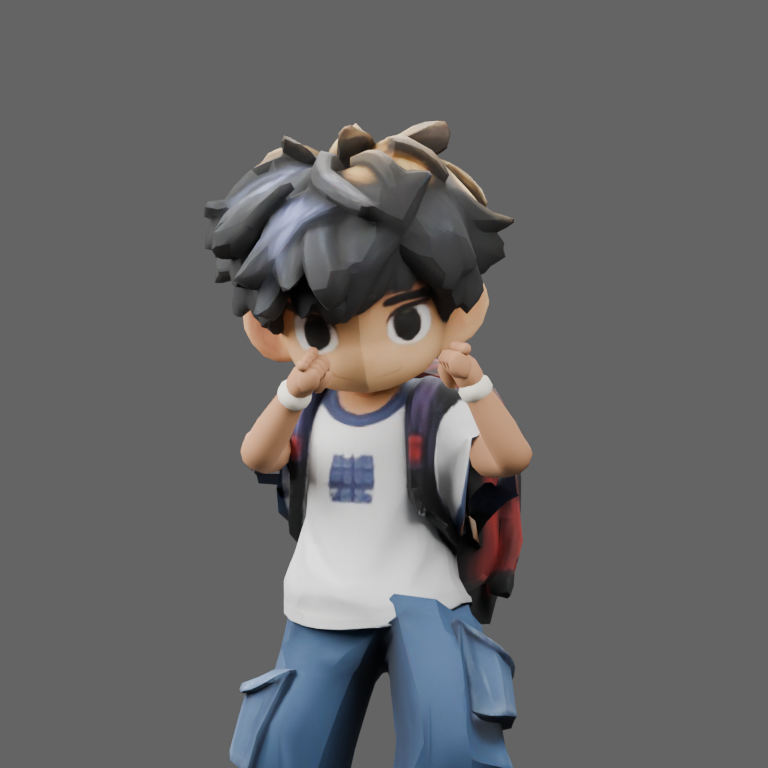

# Project High School

Game lawan 1 lawan 1 untuk telefon. Watak remaja bertarung di satu gelanggang guna silat, boxing, MMA dan capoeira. Lawan komputer dulu.

## Status: v0.6.0, Jai dengan model dan rig Blender sendiri

`index.html` ialah gelanggang latihan. **Jai**, budak gaduh jalanan tanpa disiplin tertentu, lawan kawan latih yang cuma terima pukulan. Jai kini memakai modelnya sendiri: budak sekolah berbaju putih, tali leher hitam, seluar hitam dan kasut putih, dengan rangka penuh yang dipasang dalam Blender (sampai ke jari). Kawan latih masih mannequin bersendi.

Empat butang macam pad PS5. Arah joystick (ke lawan atau undur) pilih variasi setiap butang.

| Butang | Keyboard | Gerak |
|---|---|---|
| □ Tumbuk | J | Jab. Tekan 3 kali: jab, straight, **hayun** (haymaker) |
| ← □ | A + J | Uppercut |
| △ Tendang | I | **Tendang hayun** (roundhouse ke kepala) |
| → △ | D + I | Push kick, tolak lawan ke belakang |
| ← △ | A + I | Sepak bawah ke peha |
| ○ Kasar | L | Dekat: kepit kepala (headlock, 3 uppercut, tolak). Jauh: rempuh guna bahu |
| → ○ | D + L | Lutut |
| ← ○ | A + L | Ejek, isi semula stamina |
| ✕ Tahan | K (tahan) | Tutup muka |

Joystick (sentuh separuh kiri skrin) ada kelajuan dinamik: tolak sikit jalan perlahan, tolak habis lari. Bila lari, Jai jadi rendah, condong ke depan dan tangan berayun. Keyboard: WASD atau anak panah jalan, tambah Shift untuk lari. Butang "Senarai gerak" di atas tunjuk semua gerak.

Masa latihan stamina tak terhad, jadi boleh serang tanpa henti. Butang "Penat" dalam Senarai gerak hidupkan semula stamina (setiap serangan guna stamina, kalau habis keluar "Penat!").

Bantuan jarak: kalau serangan dimula bila lawan sedikit jauh (sampai lebih kurang 0.6 m dari jarak ideal), Jai melangkah masuk sendiri sebelum pukulan sampai. Lebih jauh dari tu, pukulan tersasar.

**Kekuda (v0.6.0, ikut gambar rujukan Jai).** Gaya jalanan: dada terbuka dan berpusing ke kanan atas kaki kiri yang di depan, kepala berpaling semula ke lawan dengan dagu direndahkan. Penumbuk kiri naik di depan muka, sikunya rapat ke bawah. Penumbuk kanan yang berbalut berehat betul-betul di sebelah rahang kanan (lebih kurang 1.6 cm dari muka, jelas kelihatan), lengan bawah tegak dan siku ke bawah dan ke luar. Kedua-dua tangan digenggam jadi penumbuk; masa Ejek tangan dibuka untuk panggil lawan. Setiap serangan kembali kepada kekuda ini.

Sasaran tangan dalam kekuda, Tutup muka dan setiap gerak dipilih supaya penumbuk model Jai menyentuh muka dan badan tetapi tidak tenggelam ke dalamnya, pada setiap keyframe dan semasa badan berpusing antara keyframe. Tutup muka kini meletakkan kedua-dua penumbuk sebelah-menyebelah di depan muka (dulu ia masuk ke dalam kepala). `scripts/check-jai-rig.mjs` mengukur sedalam mana penumbuk masuk ke badan: 0 pada keyframe, paling banyak 1.3 cm sekejap antara keyframe.

**Nafas.** Masa berdiri, dada Jai naik turun (lebih kurang sekali setiap 3 saat) dan badannya bergoyang sedikit macam peninju: berat badan beralih, kepala dan tangan bergerak, lutut lentur. Bila menyerang, dia tarik nafas dan tahan. Lepas serangan habis, nafas dihembus cepat, kemudian kembali ke rentak biasa. Makin banyak bergerak dan menyerang, makin laju dan dalam nafasnya, dan bila rehat ia reda semula. Kawan latih pun bernafas, dan lebih kuat selepas kena pukul. Logik nafas dalam `src/breath.js` (diuji dalam `tests/breath.test.js`).

Pada model Jai nafas nampak pada badan sendiri: tulang `ribs` (rusuk) dan `belly` (perut) dalam rig Blender. Bila tarik nafas, rusuk mengembang ke depan dan ke sisi (bahagian depan dada naik lebih kurang 3.5 cm antara hembus penuh dan tarik penuh) dan perut ditarik masuk sedikit; belakang badan hampir tak bergerak. Ini ditambah atas gerak postur nafas yang sedia ada (dada terangkat, bahu dan tangan naik).

Pukulan yang kena beri hitstop, gegar kamera, bunyi dan nombor damage. Pukulan berturut-turut dalam 1.1 saat dikira combo. Bila HP kawan latih habis, dia jatuh (K.O.) dan bangun semula. Kamera dari sisi, sedikit di belakang Jai, supaya kedua-dua kaki nampak.

**Model Jai (v0.6.0).** `assets/models/jai-source.glb` ialah model image-to-3D asal (T-pose, 5,258 segi tiga, tanpa rangka, tanpa normal, tangan bercantum macam sarung tangan). `scripts/rig-jai.py` memasangnya dalam Blender:

```sh
blender -b --python scripts/rig-jai.py -- assets/models/jai-source.glb assets/models/jai-fighter.glb assets/models/jai-fighter.blend
```

- **Rangka 54 tulang.** Pinggul, tiga ruas tulang belakang, leher, kepala; bahu, lengan atas, siku, pergelangan; pangkal peha, lutut, buku lali, jari kaki; tiga sendi bagi setiap jari dan ibu jari (15 setiap tangan); serta `ribs` dan `belly` untuk nafas. Kedudukan sendi dibaca dari keratan rentas mesh, kemudian model diskala ke 1.75 m.
- **Berat tulang.** Mesh dicantum semula di jahitan UV (jadi satu permukaan tertutup) dan diberi berat dengan bone heat Blender (Automatic Weights). Kemudian: siku dan lutut dilentur di kawasan pendek, kasut keras ikut buku lali dan jari kaki dengan peralihan lembut di hujung seluar, dagu ikut kepala, peha tak tarik baju bila lutut diangkat.
- **Tangan.** Tangan sarung asal dibuang dan diganti tangan lima jari yang dimodelkan (tapak dan pergelangan berbalut putih macam dalam gambar rujukan). Genggaman setiap jari disimpan dalam `extras.grip`; sudut ibu jari dikira supaya ia melintang di atas jari telunjuk dan jari tengah.
- Eksport 509 KiB, 7,423 segi tiga, satu tekstur JPEG 1024². `jai-fighter.blend` mengandungi mesh, rangka, kumpulan berat, tekstur packed dan aksi `Fist` untuk diedit.

`src/fighter.js` memuat model ini atas rangkanya sendiri; `src/retarget.js` menggerakkan badan ikut mannequin (pada skala 1), kemudian tangan digenggam ikut saluran `g` dalam pose dan nafas menskala `ribs`/`belly`. `npm test` menyemak semua sendi wujud dan menggerakkan kulit, berat dinormalkan, permukaan menghadap keluar, dan 210 pose dan keyframe dengan kod game sebenar: tangan jadi penumbuk, pergelangan lurus, penumbuk tidak masuk ke badan, penumbuk kanan di sebelah rahang dalam kekuda, dada bernafas, dan tiada kulit terkoyak.



**Model Amir fighter (v0.5.2).** `assets/models/amir-fighter.glb` ialah model asal Amir yang dikemaskan dalam Blender. Bahagian lengan terdedah dibina semula dengan gelung mesh teratur, siku/lutut diberi berat tulang setempat, penumbuk lengkap dengan buku lima, ibu jari dan balutan menjadi sebahagian daripada satu mesh. Dagu dan rambut ikut tulang kepala tanpa tertarik oleh leher; beg ikut dada dan kasut ikut tulang kaki. Bentuk kepala, baju dan seluar asal dikekalkan. Eksport sekitar 811 KiB, 11,859 segi tiga dan satu tekstur 1024².

Mannequin tetap membuat pose, IK dan nafas tanpa kelihatan. `src/retarget.js` menggerakkan model mengikutnya (Amir pada skala 1.17). Tangan mengikut arah lengan bawah, jadi tangan model T-pose kekal lurus di pergelangan. Metadata `fighterReady` memastikan game tidak memasang penumbuk kedua atau mengecilkan tangan model yang sudah siap. Jika aset fighter gagal dimuat, model Amir asal digunakan.

Penumbuk kanan yang dicerminkan kini mempunyai permukaan menghadap keluar. Ujian aset memeriksa arah setiap segi tiga dan normal pada kedua-dua penumbuk, selain semakan 147 pose.

**Sumber Blender.** `assets/models/amir-fighter.blend` mengandungi mesh, tekstur packed dan rangka `DEF-*` yang boleh diedit. Bina semula eksport yang serasi dengan rig game:

```sh
blender -b --python scripts/refine-amir.py -- assets/models/amir.glb assets/models/amir-fighter.glb assets/models/amir-fighter.blend
```

Skrip mengekalkan susunan tulang dan sendi dalam `extras`, serta menambah skin glTF standard. Eksport Blender biasa perlu mengekalkan metadata dan susunan ini sebelum menggantikan GLB game. `npm test` mengesahkan saiz aset, berat tulang, bentuk kepala serta sampel pose setiap gerakan menggunakan GLTFLoader, IK dan skinning game sebenar tanpa WebGL. Render semakan di bawah menggunakan mesh yang dipose oleh kod game, dirender dalam Blender; ia bukan tangkapan skrin UI telefon.



Kekuda v0.5.3, dipose oleh kod game dan dirender dalam Blender:



Butang "Watak" dalam Senarai gerak tukar antara Jai, Amir dan mannequin. Kalau model gagal dimuat, mannequin digunakan.

`watak.html` masih tunjuk Amir dan Nur (model mocap dari Malaysian-retro-game) untuk rujukan.

```sh
npm test      # node --test tests/*.test.js
npm run dev   # http://localhost:4173
```

## Mannequin dan gerak serangan

- `src/mannequin.js`: badan 1.75 m dari segmen tegar atas rantai sendi sebenar: pinggul, tulang belakang, dada, leher, kepala; bahu, siku, pergelangan; pangkal peha, lutut, buku lali. Badan atas dipusing ikut sudut. Tangan dan kaki guna IK dua tulang: pose beri sasaran pergelangan dan buku lali, dengan arah siku dan lutut.
- `src/keyframes.js`: pose ialah objek nombor; satu gerak ialah senarai `[masa, pose]` yang diselang dengan ease.
- `src/brawler.js`: pose kekuda, semua gerak Jai (keyframe, kos stamina, tetingkap pukulan, damage, zon, knockback), combo, stamina dan headlock. Logik tulen, diuji dalam `tests/brawler.test.js`.
- `src/breath.js`: nafas: rentak, tahan nafas masa menyerang, hembus selepasnya, dan usaha yang naik dan reda
- `src/hands.js`: lipatan sendi yang tajam dan penumbuk untuk model image-to-3D
- `src/retarget.js`: gerakkan model berkulit (dari `actor.js` atau `fighter.js`) ikut mannequin yang dipose
- `src/fighter.js`: model Jai atas rangka Blendernya sendiri: genggam tangan (`grip`) dan nafas (`breathe`)
- `src/brawler-view.js`: gelanggang, kamera sisi, joystick dan butang, kesan pukulan, reaksi dan K.O. kawan latih.

## Cara watak dibina

1. **Gambar konsep → model 3D.** Gambar watak ditukar jadi model bertekstur dengan TRELLIS.2 (image-to-3D, Microsoft, lesen MIT) di Hugging Face.
2. **Sendi.** Kedudukan sendi dibaca dari render depan dan sisi, disimpan dalam `assets/models/<watak>.joints.json`: pinggul, tiga ruas tulang belakang, leher, kepala, dan untuk kiri (kanan dicerminkan) bahu, lengan atas, lengan bawah, tangan, peha, betis, kaki, jari kaki.
3. **Ikat kulit pada tulang.** `node scripts/bake-model.mjs in.glb out.glb joints.json [texture.jpg]` berdirikan model, tambah normal licin, dan beri berat setiap verteks pada tulang ikut jarak di sepanjang permukaan.
4. **Rangka dan animasi.** `src/actor.js` padankan rangka mocap pada sendi tadi, ikat model, dan mainkan klip mocap yang disesuaikan ikut panjang kaki. Kaki dikunci ke lantai.
5. **Gaya.** Shading toon dengan titik halftone dan garis dakwat (`src/illustration.js`).
6. **Sandaran.** Kalau model gagal dimuat, watak guna badan yang dibina dari kod (`src/characters.js`).

Untuk tambah watak baru: eksport watak A-pose menghadap depan sebagai GLB, tulis fail sendinya, jalankan `bake-model.mjs`, kemudian tambah dalam `MODELS` dan `DESIGNS` di `src/actor.js`.

## Susun atur kod

- `src/actor.js`: muat rangka mocap dan model, padankan rangka, retarget klip, gerak (`animate`), IK lengan dan kaki, lambai
- `src/characters.js`: badan sandaran dari kod, kepala, rambut, motif baju
- `src/outfit.js`: baju, topi dan aksesori pada model
- `src/face.js`: muka yang dilukis pada kepala
- `src/locomotion.js`: kitaran langkah dan penyelesai kaki (diuji dalam `tests/locomotion.test.js`)
- `src/actions.js`: pose tindakan untuk badan sandaran
- `src/illustration.js`: bahan toon dan garis dakwat
- `src/viewer.js`: paparan watak dalam `watak.html`
- `scripts/bake-model.mjs`: sediakan model image-to-3D untuk rangka
- `scripts/rig-jai.py`: rig Blender untuk Jai (rangka, berat, tangan lima jari, tulang nafas)
- `scripts/check-jai-rig.mjs`: semak rig Jai dengan kod game sebenar tanpa WebGL
- `scripts/dev.mjs`: pelayan tempatan
- `vendor/`: Three.js 0.186.1 (lesen MIT dalam `vendor/THREE-LICENSE.txt`)

## Aset dan kredit

- `assets/models/kids-mocap.glb`: rangka manusia 53 tulang dan 14 klip mocap dari [Universal Animation Library](https://quaternius.com/packs/universalanimationlibrary.html) oleh Quaternius (CC0)
- `assets/models/jai-source.glb`: model image-to-3D asal Jai (`sample_5.glb`, dibuat dengan trimesh) yang diberi pemilik projek; `jai-fighter.glb` dan `jai-fighter.blend` dibina daripadanya
- `assets/models/amir.glb`, `nur.glb` dan fail sendinya: dari Malaysian-retro-game, dibuat dengan TRELLIS.2. Mereka saiz budak 12 tahun (sekitar 1.5 m) dan cuma pemegang tempat sehingga watak remaja siap.

## Seterusnya

- Lawan komputer yang menyerang balik, dan tahan yang betul-betul kurangkan damage
- Mod "naik angin" untuk Jai
- Watak remaja: Aiman (silat), Danial (boxing), Hana (capoeira), Raj (MMA)
- Klip lawan: kekuda, jab, hook, tendang, elak, tahan, kena pukul, jatuh, bangun
- Hitbox pada tulang, HP dan stamina, tiga pusingan, AI komputer
- Kawalan sentuh untuk telefon dan satu gelanggang sebenar
