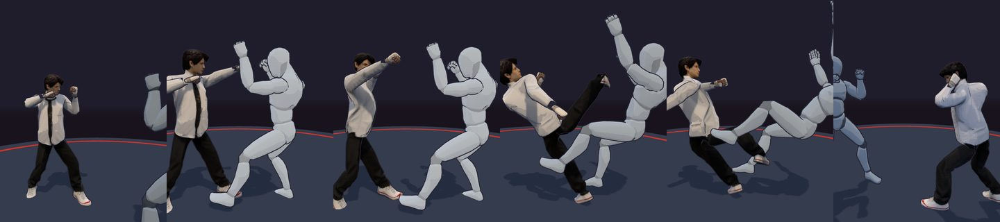

# Project High School

Game gaduh jalanan 1 lawan 1 untuk telefon. Budak sekolah bertumbuk tangan kosong, tanpa senjata. Lawan komputer dulu.

## Status: v0.6.0, gaya jalanan Jai atas tulang belakang UAL2

`index.html` ialah gelanggang latihan. **Jai**, budak gaduh jalanan, lawan kawan latih yang cuma terima pukulan. Tulang belakang kedua-dua watak kini ialah **mannequin Universal Animation Library 2** (Quaternius, CC0): satu model berkulit sekitar 1.8 m dengan rangka 65 tulang gaya Unreal, dan setiap gerak dimainkan terus dari klip animasi mocap pakej itu. Mannequin bersendi lama, IK dan gerak keyframe sudah dibuang.

**Jai tetap Jai.** Jai memakai modelnya sendiri, budak sekolah dari gambar rujukan: baju putih lengan panjang, tali leher hitam berjalur, seluar hitam dan kasut putih (`assets/models/jai-fighter.glb`, 7,423 segi tiga, dipasang rangka dalam Blender oleh `scripts/rig-jai.py` daripada `jai-source.glb`). Rangka Jai dalam T-pose dengan bingkai tulangnya sendiri, jadi `src/wear.js` memberi setiap tulangnya pusingan dunia tulang mannequin yang sepadan, dengan satu pembetulan tetap dari T-pose ke pose rehat mannequin. Jari Jai ikut genggaman dalam klip, tulang `ribs` dan `belly` bernafas, dan pinggul bergerak ikut nisbah panjang kaki. Mannequin terus bermain tanpa kelihatan dan semakan pukulan dibuat padanya (tangan Jai paling jauh 10 cm daripadanya). Butang "Watak" dalam Senarai gerak tukar antara Jai dan mannequin. Kalau model Jai gagal dimuat, mannequin digunakan. Kawan latih kekal mannequin.

**Gaya jalanan Jai.** Tangan kosong, tiada senjata. Semua gerak Jai dibina khas untuknya dan bukan klip pedang: kekuda ikut gambar rujukan Jai, tumbukan, tendangan, lutut, rempuh bahu, elak dan ejek. Setiap gerak ditulis sebagai pose dalam `src/street.js` (sasaran tangan dan kaki, sudut badan), diselesaikan dengan IK terus atas rangka mannequin UAL2 oleh `src/pose.js`, kemudian dibakar jadi klip animasi `Street_*` masa game dimuat. Klip itu dimainkan, diadun dan membawa root motion sama macam klip UAL2.

**Kekuda (ikut gambar Jai).** Dada terbuka dan berpusing atas kaki kiri yang di depan, kepala berpaling semula ke lawan dengan dagu rendah. Penumbuk kiri naik di depan muka, siku rapat ke bawah. Penumbuk kanan di sebelah rahang kanan dengan siku terbuka ke tepi, hampir paras bahu. Badan bergoyang dan bernafas masa berdiri; bila bergerak, Jai mengesot dalam kekuda (klip `Street_Shuffle`), bila lari baru tangan turun.

**Teknik pedang disimpan.** Semua teknik pedang dan perisai UAL2 (tetak, terkam, combo, tangkis, hentak dan rempuh tong) disimpan dalam `src/sword.js` bersama klipnya dalam `fighter.glb`, tidak dimainkan dalam gaduh jalanan.

Empat butang macam pad PS5. Arah joystick pilih variasi setiap butang.

| Butang | Keyboard | Gerak |
|---|---|---|
| □ Tumbuk | J | Jab. Tekan 3 kali: jab, straight, **hook** |
| → □ | D + J | Hook |
| ← □ | A + J | Uppercut |
| △ Tendang | I | **Tendang tinggi** ke kepala (roundhouse) |
| → △ | D + I | Tendang tolak (teep) |
| ← △ | A + I | Tendang bawah ke peha (low kick) |
| ○ Kasar | L | Lutut |
| → ○ | D + L | Rempuh bahu |
| ← ○ | A + L | Ejek, isi semula stamina |
| ✕ Tahan | K (tahan) | Tutup muka |
| ✕ + ↑ / ↓ | W / S + K | Elak kiri / kanan (slip) |
| → ✕ | D + K | Tunduk (duck) |
| ← ✕ | A + K | Undur (lompat ke belakang) |

Elak ada tetingkap `evade` (kepala keluar dari garis serangan) untuk lawan komputer nanti.

Kawan latih berdiri dalam kekuda yang sama. Bila kena: Hit_Knockback (tersentak bila kena pukulan ringan, jatuh terlentang bila kena pukulan berat) dan LayToIdle untuk bangun, dari UAL2; `Street_Block` bila dia tutup muka dan Idle_Shield_Break bila tahanannya pecah. Butang "Kawan" dalam Senarai gerak suruh dia tutup muka: pukulan ringan cuma kena 20% damage, pukulan berat pecahkan tahanan (60%).

Joystick (sentuh separuh kiri skrin) ada kelajuan dinamik: tolak sikit jalan, tolak habis lari. Idle, jalan, jog dan pecut (dari Universal Animation Library 1, rangka yang sama) diadun ikut laju dan kakinya kekal serentak. Keyboard: WASD atau anak panah jalan, tambah Shift untuk lari.

Masa latihan stamina tak terhad. Butang "Penat" dalam Senarai gerak hidupkan semula stamina (setiap serangan guna stamina, kalau habis keluar "Penat!").

**Root motion.** Klip dari `UAL2_Standard_RM.glb` membawa pergerakan badan pada tulang `root`. Game membaca laluan itu dan menggerakkan watak (didarab `rm` setiap gerak supaya muat dalam gelanggang), tapi Jai tidak akan dibawa lebih dekat daripada jarak terbaik geraknya (`reach`). Kalau serangan dimula sedikit jauh (sampai 0.9 m lebih), Jai melangkah masuk sendiri sebelum pukulan sampai. Lebih jauh dari tu, pukulan tersasar.

**Pukulan.** Yang memukul cuma penumbuk, kaki, lutut kanan dan bahu kiri. Tetingkap pukulan ikut keyframe setiap gerak. Titik pukulan diseret dari bingkai lepas, jadi pukulan laju tidak terlepas sasaran (kepala, dada, pinggul, betis, kaki). Semakan pukulan dibuat atas mannequin; tangan Jai paling jauh 10 cm daripadanya kerana kedua-duanya ikut sasaran IK yang sama.

**Nafas.** Rentak nafas dalam `src/breath.js` masih digunakan: dada mannequin naik turun di atas animasi, ditahan masa menyerang dan dihembus selepasnya.

Pukulan yang kena beri hitstop, gegar kamera, bunyi dan nombor damage. Pukulan berturut-turut dalam 1.1 saat dikira combo. Bila HP kawan latih habis dia jatuh (K.O.) dan bangun semula. Kamera dari sisi, sedikit di belakang Jai.



```sh
npm test      # node --test tests/*.test.js
npm run dev   # http://localhost:4173
```

## Model fighter

`assets/models/fighter.glb` (sekitar 1.7 MiB, 13.7k segi tiga, tanpa tekstur) dibina oleh skrip daripada pakej Universal Animation Library 2 [Standard]:

```sh
node scripts/build-fighter.mjs "<UAL2>/Unreal-Godot/UAL2_Standard_RM.glb" assets/models/kids-mocap.glb assets/models/fighter.glb
```

Skrip ambil mesh, rangka dan 25 klip dari UAL2 (teknik pedang yang disimpan, reaksi jatuh dan bangun, dan lain-lain), serta Idle/Walk/Jog/Sprint dari `kids-mocap.glb` (UAL1, rangka yang sama dengan nama tulang Rigify yang ditukar balik ke nama UAL2). Channel skala, tulang hujung jari dan channel yang tidak pernah bergerak dari rehat dibuang supaya fail kecil. Klip lain dalam pakej (baling, bertani, kerusi, telefon dan lain-lain) tidak dimasukkan. `npm test` sahkan setiap klip yang digunakan ada dengan panjang yang betul, setiap klip ada root motion, dalam setiap tetingkap pukulan bahagian yang memukul memang sampai ke depan, setiap tulang Jai digerakkan oleh mannequin, mesh Jai kekal utuh dalam setiap gerak dan tangannya kekal dekat tangan mannequin, menggunakan kod game sebenar (GLTFLoader, AnimationMixer, skinning) tanpa WebGL.

`tests/jai-model.test.js` semak rangka penuh Jai (sampai ke jari dan tulang nafas), berat tulang, permukaan dan genggaman. Bina semula rig Jai dengan Blender:

```sh
blender -b --python scripts/rig-jai.py -- assets/models/jai-source.glb assets/models/jai-fighter.glb assets/models/jai-fighter.blend
```

Model Amir fighter (`amir-fighter.glb`, `amir-fighter.blend`, `scripts/refine-amir.py`) masih ada dan diuji dalam `tests/amir-model.test.js`, tetapi tidak lagi digunakan dalam gelanggang.

## Susun atur gaduh

- `src/street.js`: pose gaya jalanan Jai (kekuda, tutup muka, tumbukan, tendangan, lutut, rempuh, elak, ejek, gelung berdiri dan mengesot). Data tulen.
- `src/keyframes.js`: selang pose antara keyframe (ease, 'in' untuk hentaman, 'out' untuk reda)
- `src/pose.js`: selesaikan pose atas rangka UAL2 (sudut badan, IK dua tulang untuk tangan dan kaki, genggaman jari) dan bakar klip `Street_*`
- `src/sword.js`: teknik pedang dan perisai yang disimpan
- `src/brawler.js`: logik tulen: panjang klip, setiap gerak (segmen klip, kos stamina, tetingkap pukulan, damage, knockback, root motion, elak), chain jab-straight-hook, ejek, stamina, dan reaksi kawan latih (tersentak, jatuh, K.O., tahan, pecah tahan). Diuji dalam `tests/brawler.test.js`.
- `src/wear.js`: pakaikan model Jai pada fighter: retarget setiap tulang (badan dan jari) dari mannequin, pinggul dan nafas.
- `src/fighter.js`: muat `fighter.glb`, klon untuk setiap watak, adun klip ikut masa dan berat yang game tetapkan setiap bingkai, root motion, nafas, titik pukulan dan sasaran.
- `src/breath.js`: nafas: rentak, tahan nafas masa menyerang, hembus selepasnya, dan usaha yang naik dan reda
- `src/brawler-view.js`: gelanggang, kamera sisi, joystick dan butang, semakan pukulan, kesan pukulan, reaksi dan K.O. kawan latih.
- `scripts/build-fighter.mjs`: bina `fighter.glb`; `scripts/check-fighter.mjs`: semak rig dengan kod game.

## Cara watak dibina

1. **Gambar konsep → model 3D.** Gambar watak ditukar jadi model bertekstur dengan TRELLIS.2 (image-to-3D, Microsoft, lesen MIT) di Hugging Face.
2. **Sendi.** Kedudukan sendi dibaca dari render depan dan sisi, disimpan dalam `assets/models/<watak>.joints.json`: pinggul, tiga ruas tulang belakang, leher, kepala, dan untuk kiri (kanan dicerminkan) bahu, lengan atas, lengan bawah, tangan, peha, betis, kaki, jari kaki.
3. **Ikat kulit pada tulang.** `node scripts/bake-model.mjs in.glb out.glb joints.json [texture.jpg]` berdirikan model, tambah normal licin, dan beri berat setiap verteks pada tulang ikut jarak di sepanjang permukaan.
4. **Rangka dan animasi.** `src/actor.js` padankan rangka mocap pada sendi tadi, ikat model, dan mainkan klip mocap yang disesuaikan ikut panjang kaki. Kaki dikunci ke lantai.
5. **Gaya.** Shading toon dengan titik halftone dan garis dakwat (`src/illustration.js`).
6. **Sandaran.** Kalau model gagal dimuat, watak guna badan yang dibina dari kod (`src/characters.js`).

Untuk tambah watak baru: eksport watak A-pose menghadap depan sebagai GLB, tulis fail sendinya, jalankan `bake-model.mjs`, kemudian tambah dalam `MODELS` dan `DESIGNS` di `src/actor.js`.

## Susun atur kod

- `src/actor.js`: muat rangka mocap dan model, padankan rangka, retarget klip, gerak (`animate`), IK lengan dan kaki, lambai
- `src/characters.js`: badan sandaran dari kod, kepala, rambut, motif baju
- `src/outfit.js`: baju, topi dan aksesori pada model
- `src/face.js`: muka yang dilukis pada kepala
- `src/locomotion.js`: kitaran langkah dan penyelesai kaki (diuji dalam `tests/locomotion.test.js`)
- `src/actions.js`: pose tindakan untuk badan sandaran
- `src/illustration.js`: bahan toon dan garis dakwat
- `src/viewer.js`: paparan watak dalam `watak.html`
- `scripts/bake-model.mjs`: sediakan model image-to-3D untuk rangka
- `scripts/dev.mjs`: pelayan tempatan
- `vendor/`: Three.js 0.186.1 (lesen MIT dalam `vendor/THREE-LICENSE.txt`)

## Aset dan kredit

- `assets/models/fighter.glb`: mannequin dan klip dari [Universal Animation Library 2](https://quaternius.com) ([penonton animasi](https://quaternius.com/animviewer.html)) [Standard] oleh Quaternius (CC0), dengan idle dan lokomosi dari UAL1
- `assets/models/kids-mocap.glb`: rangka manusia 53 tulang dan 14 klip mocap dari [Universal Animation Library](https://quaternius.com/packs/universalanimationlibrary.html) oleh Quaternius (CC0); dipakai `watak.html` dan sebagai sumber lokomosi `fighter.glb`
- `assets/models/jai-source.glb`: model image-to-3D asal Jai yang diberi pemilik projek; `jai-fighter.glb` dan `jai-fighter.blend` dibina daripadanya
- `assets/models/amir.glb`, `nur.glb` dan fail sendinya: dari Malaysian-retro-game, dibuat dengan TRELLIS.2. Mereka saiz budak 12 tahun (sekitar 1.5 m) dan cuma pemegang tempat sehingga watak remaja siap.

## Seterusnya

- Lawan komputer yang menyerang balik (klip yang sama), dan tahan Jai yang kurangkan damage
- Mannequin perempuan UAL2 (rangka sama) untuk watak seperti Hana
- Mod "naik angin" untuk Jai
- Watak remaja lain untuk dilawan: Aiman, Danial, Hana, Raj (semua gaduh jalanan)
- Hitbox pada tulang, HP dan stamina, tiga pusingan, AI komputer
- Kawalan sentuh untuk telefon dan satu gelanggang sebenar
