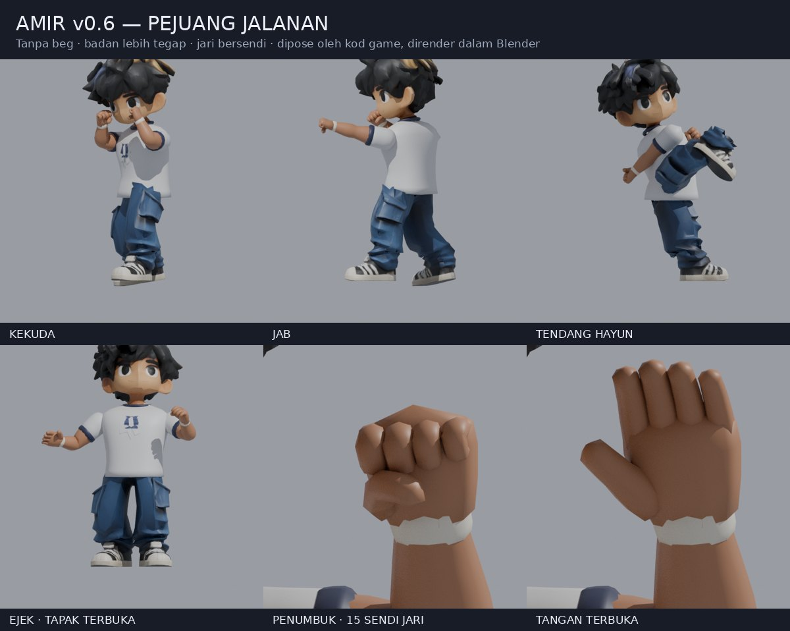

# Project High School

Game lawan 1 lawan 1 untuk telefon. Watak remaja bertarung di satu gelanggang guna silat, boxing, MMA dan capoeira. Lawan komputer dulu.

## Status: v0.6.1, Amir pejuang jalanan

`index.html` ialah gelanggang latihan. **Jai**, budak gaduh jalanan tanpa disiplin tertentu, lawan kawan latih yang cuma terima pukulan. Jai memakai model Amir yang dikemaskan dalam Blender (tanpa beg, badan tegap, jari bersendi); kawan latih masih mannequin bersendi.

Empat butang macam pad PS5. Arah joystick (ke lawan atau undur) pilih variasi setiap butang.

| Butang | Keyboard | Gerak |
|---|---|---|
| □ Tumbuk | J | Jab. Tekan 3 kali: jab, straight, **hayun** (haymaker) |
| ← □ | A + J | Uppercut |
| △ Tendang | I | **Tendang hayun** (roundhouse ke kepala) |
| → △ | D + I | Push kick, tolak lawan ke belakang |
| ← △ | A + I | Sepak bawah ke peha |
| ○ Kasar | L | Dekat: kepit kepala (headlock, 3 uppercut, tolak). Jauh: rempuh guna bahu |
| → ○ | D + L | Lutut |
| ← ○ | A + L | Ejek, isi semula stamina |
| ✕ Tahan | K (tahan) | Tutup muka |

Joystick (sentuh separuh kiri skrin) ada kelajuan dinamik: tolak sikit jalan perlahan, tolak habis lari. Bila lari, Jai jadi rendah, condong ke depan dan tangan berayun. Keyboard: WASD atau anak panah jalan, tambah Shift untuk lari. Butang "Senarai gerak" di atas tunjuk semua gerak.

Masa latihan stamina tak terhad, jadi boleh serang tanpa henti. Butang "Penat" dalam Senarai gerak hidupkan semula stamina (setiap serangan guna stamina, kalau habis keluar "Penat!").

Bantuan jarak: kalau serangan dimula bila lawan sedikit jauh (sampai lebih kurang 0.6 m dari jarak ideal), Jai melangkah masuk sendiri sebelum pukulan sampai. Lebih jauh dari tu, pukulan tersasar.

**Kekuda.** Kedua-dua penumbuk di sisi muka, siku terbuka sedikit dan menghala ke bawah, dagu direndahkan serta badan condong sedikit ke depan. Bahu kurang menyerong dan lengan belakang tidak lagi melintang di depan dada. Kaki kiri di depan dan tapak kekal lebar untuk imbangan. Setiap serangan kembali kepada kekuda ini.

**Gaya jalanan.** Masa berdiri, Jai melantun atas hujung kaki (tumit terangkat, lutut lentur setiap kali mendarat), bahu berguling berselang-seli, kepala bergoyang dan mengelak, dan tangan depan sesekali menjolok ke depan (paw) sambil jari terbuka sedikit. Bila berjalan dia mengesot rendah atas hujung kaki dengan bahu ikut langkah; bila lari, badan rendah dan tangan berayun seperti dulu.

**Nafas.** Masa berdiri, dada Jai naik turun (lebih kurang sekali setiap 3 saat) dan badannya bergoyang sedikit macam peninju: berat badan beralih, kepala dan tangan bergerak, lutut lentur. Bila menyerang, dia tarik nafas dan tahan. Lepas serangan habis, nafas dihembus cepat, kemudian kembali ke rentak biasa. Makin banyak bergerak dan menyerang, makin laju dan dalam nafasnya, dan bila rehat ia reda semula. Kawan latih pun bernafas, dan lebih kuat selepas kena pukul. Logik nafas dalam `src/breath.js` (diuji dalam `tests/breath.test.js`).

Pukulan yang kena beri hitstop, gegar kamera, bunyi dan nombor damage. Pukulan berturut-turut dalam 1.1 saat dikira combo. Bila HP kawan latih habis, dia jatuh (K.O.) dan bangun semula. Kamera dari sisi, sedikit di belakang Jai, supaya kedua-dua kaki nampak.

**Model Amir fighter (v0.6.0).** `assets/models/amir-fighter.glb` dibina daripada model asal Amir dalam Blender:

- **Tanpa beg.** Imbasan TRELLIS tiada baju di bawah beg (beg itulah belakang badan), jadi baju imbasan, tali beg dan beg dibuang. Kepala, rambut, muka, leher, logo dada, seluar dan kasut kekal seperti asal.
- **Badan pejuang.** Badan baju baru dibina daripada gelang superelips: dada dan bahu lebar, belakang rata, perut leper. Lengan baju bulat dengan jalur biru gelap dan kolar biru gelap baru. Bahu (dan seluruh lengan) dianjak 2.6 cm ke luar; lengan atas, lengan bawah dan leher lebih tebal. Logo dada asal dipindah sebagai decal atas dada baru.
- **Jari bersendi.** Setiap tangan ada tapak, empat jari dan ibu jari, masing-masing tiga ruas pada tulang jari rig mocap (`thumb01..03`, `f_index01..03`, `f_middle`, `f_ring`, `f_pinky`). Gelang sendi dikongsi separuh-separuh antara dua tulang, ruas lain tegar. Tangan dibesarkan 1.45 kali dari pergelangan supaya penumbuk nampak tebal dan jelas di skrin telefon. Balutan pergelangan ikut lengan bawah dan tangan.

Eksport sekitar 705 KiB, 10,218 segi tiga, 52 tulang dan satu tekstur 1024² (jalur palet 32 px untuk kulit, balutan, baju dan biru gelap).

Mannequin tetap membuat pose, IK dan nafas tanpa kelihatan. `src/retarget.js` menggerakkan model mengikutnya, pada skala 1.17. `actor.js` meletakkan tulang jari rig pada sendi jari model. Setiap pose ada `g: [kiri, kanan]` (0 tapak terbuka, 1 penumbuk); retarget membengkokkan setiap sendi jari ke arah tapak, dan ibu jari melipat merentasi jari. Semua tumbukan genggam penumbuk; ejek buka kedua-dua tapak dan tangan kiri melambai "mari"; kepit kepala menekup leher dengan tangan kiri. Jika aset fighter gagal dimuat, model Amir asal digunakan.

**Sumber Blender.** `assets/models/amir-fighter.blend` mengandungi mesh, tekstur packed dan rangka `DEF-*` yang boleh diedit. Bina semula eksport yang serasi dengan rig game:

```sh
blender -b --python scripts/refine-amir.py -- assets/models/amir.glb assets/models/amir-fighter.glb assets/models/amir-fighter.blend
# atau, dengan modul Python Blender (pip install bpy):
python3 scripts/refine-amir.py -- assets/models/amir.glb assets/models/amir-fighter.glb assets/models/amir-fighter.blend
```

Skrip mengekalkan susunan tulang dan sendi dalam `extras`, serta menambah skin glTF standard. Eksport Blender biasa perlu mengekalkan metadata dan susunan ini sebelum menggantikan GLB game. `npm test` mengesahkan saiz aset, berat tulang, bentuk kepala, arah permukaan tapak dan setiap ruas jari, penumbuk yang tertutup dan tapak yang terbuka, serta sampel pose setiap gerakan menggunakan GLTFLoader, IK dan skinning game sebenar tanpa WebGL. Render semakan di bawah menggunakan mesh yang dipose oleh kod game, dirender dalam Blender; ia bukan tangkapan skrin UI telefon.



Butang "Watak" dalam Senarai gerak tukar antara Amir dan mannequin. Kalau model gagal dimuat, mannequin digunakan.

`watak.html` masih tunjuk Amir dan Nur (model mocap dari Malaysian-retro-game) untuk rujukan.

```sh
npm test      # node --test tests/*.test.js
npm run dev   # http://localhost:4173
```

## Mannequin dan gerak serangan

- `src/mannequin.js`: badan 1.75 m dari segmen tegar atas rantai sendi sebenar: pinggul, tulang belakang, dada, leher, kepala; bahu, siku, pergelangan; pangkal peha, lutut, buku lali. Badan atas dipusing ikut sudut. Tangan dan kaki guna IK dua tulang: pose beri sasaran pergelangan dan buku lali, dengan arah siku dan lutut.
- `src/keyframes.js`: pose ialah objek nombor; satu gerak ialah senarai `[masa, pose]` yang diselang dengan ease.
- `src/brawler.js`: pose kekuda, semua gerak Jai (keyframe, kos stamina, tetingkap pukulan, damage, zon, knockback), combo, stamina dan headlock. Logik tulen, diuji dalam `tests/brawler.test.js`.
- `src/breath.js`: nafas: rentak, tahan nafas masa menyerang, hembus selepasnya, dan usaha yang naik dan reda
- `src/hands.js`: lipatan sendi yang tajam dan penumbuk untuk model image-to-3D
- `src/retarget.js`: gerakkan model berkulit (dari `actor.js`) ikut mannequin yang dipose
- `src/brawler-view.js`: gelanggang, kamera sisi, joystick dan butang, kesan pukulan, reaksi dan K.O. kawan latih.

## Cara watak dibina

1. **Gambar konsep → model 3D.** Gambar watak ditukar jadi model bertekstur dengan TRELLIS.2 (image-to-3D, Microsoft, lesen MIT) di Hugging Face.
2. **Sendi.** Kedudukan sendi dibaca dari render depan dan sisi, disimpan dalam `assets/models/<watak>.joints.json`: pinggul, tiga ruas tulang belakang, leher, kepala, dan untuk kiri (kanan dicerminkan) bahu, lengan atas, lengan bawah, tangan, peha, betis, kaki, jari kaki.
3. **Ikat kulit pada tulang.** `node scripts/bake-model.mjs in.glb out.glb joints.json [texture.jpg]` berdirikan model, tambah normal licin, dan beri berat setiap verteks pada tulang ikut jarak di sepanjang permukaan.
4. **Rangka dan animasi.** `src/actor.js` padankan rangka mocap pada sendi tadi, ikat model, dan mainkan klip mocap yang disesuaikan ikut panjang kaki. Kaki dikunci ke lantai.
5. **Gaya.** Shading toon dengan titik halftone dan garis dakwat (`src/illustration.js`).
6. **Sandaran.** Kalau model gagal dimuat, watak guna badan yang dibina dari kod (`src/characters.js`).

Untuk tambah watak baru: eksport watak A-pose menghadap depan sebagai GLB, tulis fail sendinya, jalankan `bake-model.mjs`, kemudian tambah dalam `MODELS` dan `DESIGNS` di `src/actor.js`.

## Susun atur kod

- `src/actor.js`: muat rangka mocap dan model, padankan rangka, retarget klip, gerak (`animate`), IK lengan dan kaki, lambai
- `src/characters.js`: badan sandaran dari kod, kepala, rambut, motif baju
- `src/outfit.js`: baju, topi dan aksesori pada model
- `src/face.js`: muka yang dilukis pada kepala
- `src/locomotion.js`: kitaran langkah dan penyelesai kaki (diuji dalam `tests/locomotion.test.js`)
- `src/actions.js`: pose tindakan untuk badan sandaran
- `src/illustration.js`: bahan toon dan garis dakwat
- `src/viewer.js`: paparan watak dalam `watak.html`
- `scripts/bake-model.mjs`: sediakan model image-to-3D untuk rangka
- `scripts/dev.mjs`: pelayan tempatan
- `vendor/`: Three.js 0.186.1 (lesen MIT dalam `vendor/THREE-LICENSE.txt`)

## Aset dan kredit

- `assets/models/kids-mocap.glb`: rangka manusia 53 tulang dan 14 klip mocap dari [Universal Animation Library](https://quaternius.com/packs/universalanimationlibrary.html) oleh Quaternius (CC0)
- `assets/models/amir.glb`, `nur.glb` dan fail sendinya: dari Malaysian-retro-game, dibuat dengan TRELLIS.2. Mereka saiz budak 12 tahun (sekitar 1.5 m) dan cuma pemegang tempat sehingga watak remaja siap.

## Seterusnya

- Lawan komputer yang menyerang balik, dan tahan yang betul-betul kurangkan damage
- Mod "naik angin" untuk Jai
- Watak remaja: Aiman (silat), Danial (boxing), Hana (capoeira), Raj (MMA)
- Klip lawan: kekuda, jab, hook, tendang, elak, tahan, kena pukul, jatuh, bangun
- Hitbox pada tulang, HP dan stamina, tiga pusingan, AI komputer
- Kawalan sentuh untuk telefon dan satu gelanggang sebenar
